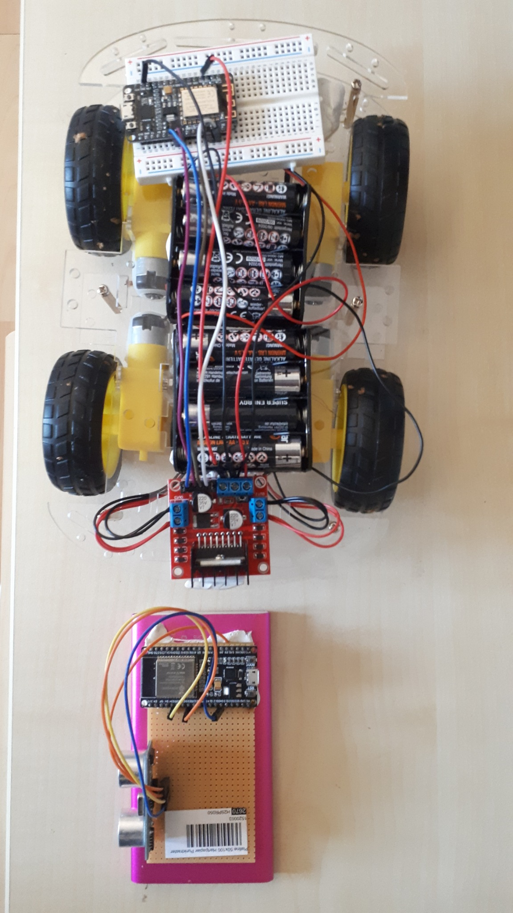
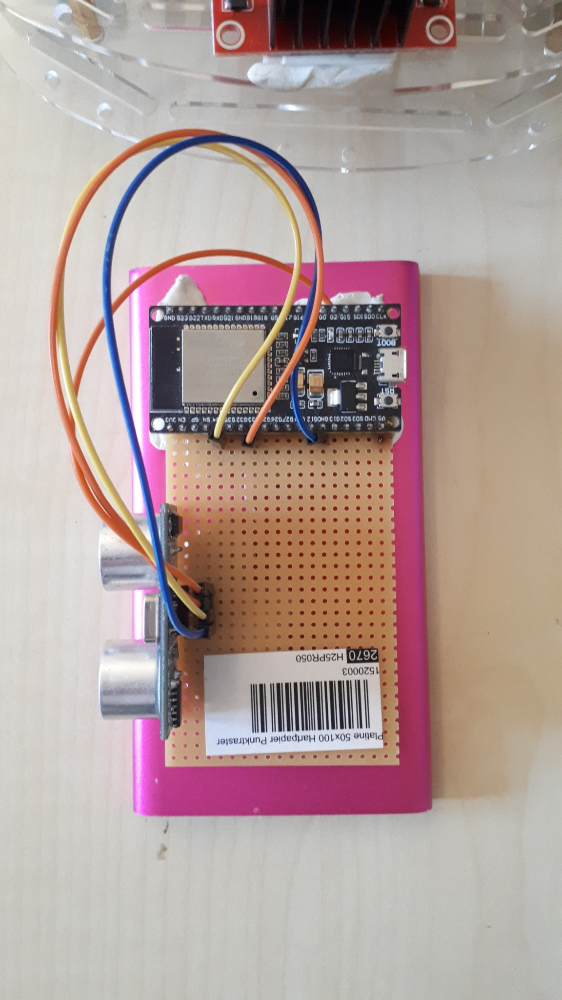
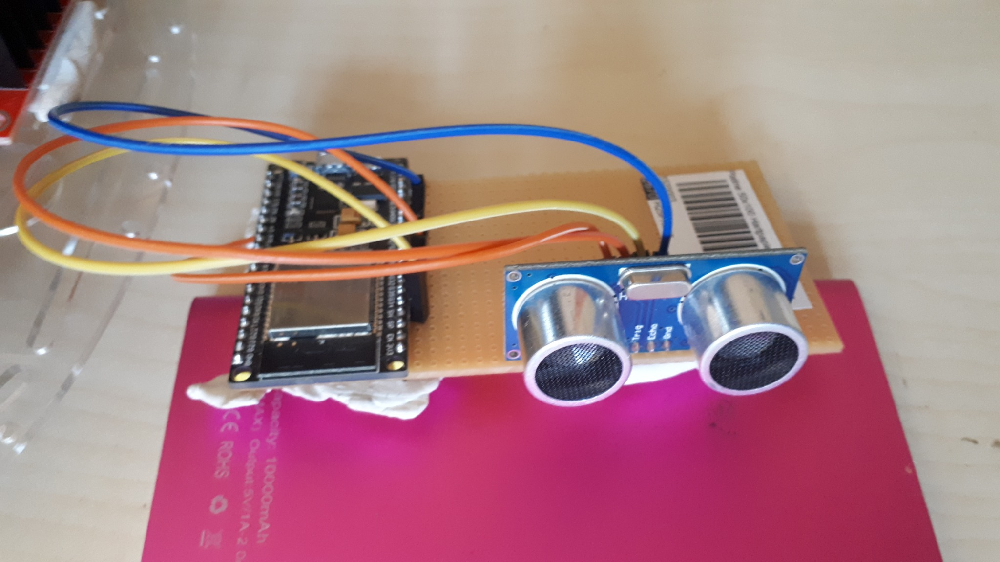

# ESP32 + ESP8266 Hand-Controlled Robot Car

<p align="center">
  
</p>

<p align="center">
  <b>A wireless 4WD robot car controlled by hand distance — no phone, joystick, or Wi-Fi router required.</b>
</p>

## Overview

This project is a DIY 4-wheel robot car controlled by moving a hand in front of an HC-SR04 ultrasonic sensor. An ESP32 measures the hand distance, converts it into a movement command, and transmits that command wirelessly to an ESP8266 using ESP-NOW. The ESP8266 controls an L298N dual H-bridge motor driver, which drives four TT DC gear motors.

The repository documents not only the final result, but also the development process: communication testing, sensor testing, motor-driver testing, integration, power-supply debugging, and the final firmware.

## System Architecture

```text
          HAND
            |
            v
      +-------------+
      |   HC-SR04   |
      +-------------+
            |
       distance (cm)
            |
            v
      +-------------+
      |    ESP32    |  Hand controller
      +-------------+
            |
          ESP-NOW
       wireless link
            |
            v
      +-------------+
      |   ESP8266   |  Robot car
      +-------------+
            |
            v
      +-------------+
      |    L298N    |
      +-------------+
        |         |
     left side  right side
       motors      motors
```

## Features

- Wireless ESP32 → ESP8266 control using ESP-NOW
- Hand-distance control with HC-SR04
- No Wi-Fi router required
- No Bluetooth required
- Four-wheel drive using four TT gear motors
- L298N dual-channel motor control
- Averaged ultrasonic measurements for more stable commands
- Fail-safe STOP when no valid ultrasonic echo is detected
- Fully documented development and troubleshooting process

## Hardware

| Component | Quantity | Purpose |
|---|---:|---|
| ESP32 development board | 1 | Hand controller / transmitter |
| ESP8266 NodeMCU (ESP-12F module) | 1 | Robot receiver / motor controller |
| HC-SR04 ultrasonic sensor | 1 | Measures hand distance |
| L298N motor driver | 1 | Drives left and right motor pairs |
| TT DC gear motor | 4 | Robot propulsion |
| 4WD acrylic chassis + wheels | 1 | Mechanical platform |
| AA batteries | 8 final configuration | Robot power source |
| Perfboard / prototype board | 1 | Hand-controller assembly |
| Jumper wires | — | Electrical connections |

> [!IMPORTANT]
> The HC-SR04 ECHO output is a 5 V logic signal, while ESP32 GPIOs are 3.3 V devices. Use an appropriate voltage divider or level shifter on ECHO before connecting it to the ESP32.

## Final Wiring

### ESP32 Hand Controller

| HC-SR04 | ESP32 |
|---|---|
| TRIG | GPIO 33 |
| ECHO | GPIO 34 through a safe level-shifting/divider circuit |
| VCC | 5 V |
| GND | GND |

### ESP8266 → L298N

| ESP8266 | GPIO | L298N |
|---|---:|---|
| D1 | GPIO 5 | IN1 |
| D2 | GPIO 4 | IN2 |
| D5 | GPIO 14 | IN3 |
| D6 | GPIO 12 | IN4 |
| GND | — | GND |

ENA and ENB are enabled with the L298N jumpers in the final build. The final version therefore uses full motor power rather than PWM speed control.

Two motors on one side of the chassis are connected to OUT1/OUT2 and the two motors on the opposite side to OUT3/OUT4.

## Hand-Control Logic

| Measured distance | Command |
|---:|---|
| Invalid / no echo | STOP |
| `< 12 cm` | REVERSE |
| `12–20 cm` | STOP |
| `20–35 cm` | FORWARD |
| `> 35 cm` | STOP |

The ESP32 averages five measurements. At least three valid readings are required before a distance is accepted. This reduces unstable commands caused by occasional ultrasonic measurement errors.

## Development Journey

### Stage 1 — Test ESP-NOW Before Building the Full Robot

The wireless link was tested first, independently from the motors. The ESP32 transmitted a small data structure containing a text command and distance value. The ESP8266 printed received packets to the Serial Monitor.

This was deliberate: if wireless communication works before motors are introduced, later failures can be isolated much more easily.

Test sketches are available in [`firmware/01-espnow-communication-test`](firmware/01-espnow-communication-test/).

### Stage 2 — Test the Ultrasonic Sensor

The HC-SR04 was then tested separately. The ESP32 generated a 10 µs trigger pulse, measured the echo duration, and converted it into distance.

Invalid measurements and timeouts were treated as errors rather than movement commands. Later, five samples were averaged to make hand control more stable.

See [`firmware/02-ultrasonic-sensor-test`](firmware/02-ultrasonic-sensor-test/).

### Stage 3 — Test the L298N and Motors

Before connecting wireless control to the drivetrain, the ESP8266 and L298N were tested with simple forward, reverse, and stop functions.

The final motor mapping is D1/D2 for one L298N channel and D5/D6 for the other.

See [`firmware/03-motor-driver-test`](firmware/03-motor-driver-test/).

### Stage 4 — Integrate Wireless Commands and Motor Control

Once each subsystem worked independently, ESP-NOW reception was connected to the motor functions. The receiver compares the incoming command with `VORWAERTS`, `RUECKWAERTS`, or `STOP` and drives the L298N accordingly.

This staged integration was useful because communication, sensing, and motor control had already been verified separately.

### Stage 5 — Diagnose the Power Problem

The first complete setup did **not** behave reliably with the original four-AA battery configuration (~6 V nominal).

Symptoms included:

- motors buzzing instead of starting,
- the robot working better with the wheels lifted,
- two motors starting more reliably than all four,
- behavior that initially looked like a software or communication problem.

One L298N motor channel was disconnected and only two motors were tested. Those motors started strongly, which was a major clue that the software was not the primary problem.

The final robot used **eight AA batteries electrically connected in series (~12 V nominal with 1.5 V cells)**. With the final power configuration, the complete robot was able to operate reliably.

> [!CAUTION]
> Series-connected batteries increase voltage. Eight fresh 1.5 V AA cells are approximately 12 V nominal. **Do not connect this voltage directly to the ESP8266 3V3 pin or directly to 3.3 V electronics.** Use a suitable regulated supply path and verify voltages with a multimeter before connecting electronics. Also verify that your particular motors and motor driver are operated within their ratings.

For the full engineering notes, see [`docs/power-supply.md`](docs/power-supply.md).

### Stage 6 — PWM Experiment

PWM speed control was tested during development. In our physical build, reduced PWM drive caused undesirable buzzing and unreliable motor startup. For the final configuration, the ENA and ENB jumpers were installed and the motors were operated at full enabled output.

This is documented because unsuccessful experiments are useful information for anyone reproducing the project.

### Stage 7 — Final Hand-Control Algorithm

The first distance zones were refined after real-world testing. The final algorithm includes a neutral STOP region between reverse and forward, an upper STOP region, invalid-reading protection, and measurement averaging.

The finished firmware is in [`firmware/final`](firmware/final/).

## Original Project Photos

### Hand Controller — Top View

<p align="center"></p>

### HC-SR04 and ESP32 Controller

<p align="center"></p>

### Complete System

<p align="center"></p>

## Arduino IDE Setup

The project was developed with Arduino IDE. The tested development setup included:

- Arduino IDE 2.3.10
- ESP32 core by Espressif Systems 3.3.12
- ESP32 board selection: `ESP32 Dev Module`
- ESP8266 board selection: `NodeMCU 1.0 (ESP-12E Module)` for the NodeMCU-style ESP-12F board used in the project
- Serial Monitor: `115200 baud`

## Build Order for Reproducing the Project

1. Install ESP32 and ESP8266 board support in Arduino IDE.
2. Determine the ESP8266 station MAC address.
3. Run the ESP-NOW communication test.
4. Verify that commands arrive in the ESP8266 Serial Monitor.
5. Build and test the HC-SR04 circuit separately.
6. Test one motor pair through the L298N.
7. Test both motor channels and all four motors.
8. Connect the ESP-NOW receiver logic to the motor functions.
9. Upload the final ESP32 hand-controller firmware.
10. Upload the final ESP8266 robot-car firmware.
11. Verify all supply voltages before connecting the final battery configuration.
12. Test with the wheels lifted first, then test on the floor.

## ESP-NOW Peer Address

The ESP32 sender needs the MAC address of the ESP8266 receiver. **Do not blindly copy the address from this project.** Every board has its own MAC address.

In the final ESP32 sketch, replace:

```cpp
uint8_t empfaengerMAC[] = { 0xFC, 0xEA, 0xBC, 0x58, 0xAC, 0x7C };
```

with the station MAC address of your own ESP8266.

## Troubleshooting

| Problem | Likely cause / check |
|---|---|
| ESP32 sends but car does nothing | Verify receiver MAC and ESP-NOW initialization |
| Motors buzz but do not start | Check battery condition, voltage under load, wiring and mechanical load |
| Two motors work but four do not | Power source may be inadequate under total load |
| Wheels spin in the air but car cannot move | Check battery voltage/current capability and drivetrain load |
| Direction is reversed | Swap the relevant motor pair wires or adjust motor logic |
| Distance jumps randomly | Check HC-SR04 wiring, ECHO level shifting, sensor orientation and smoothing |
| ESP resets when motors start | Investigate supply voltage drop, grounding and power distribution |
| No ultrasonic echo | Final firmware sends STOP for safety |

More details: [`docs/troubleshooting.md`](docs/troubleshooting.md).

## Repository Structure

```text
.
├── README.md
├── LICENSE
├── firmware/
│   ├── 01-espnow-communication-test/
│   ├── 02-ultrasonic-sensor-test/
│   ├── 03-motor-driver-test/
│   └── final/
│       ├── esp32_hand_controller/
│       └── esp8266_robot_car/
├── docs/
│   ├── hardware.md
│   ├── wiring.md
│   ├── development-journey.md
│   ├── power-supply.md
│   └── troubleshooting.md
├── images/
└── media/
```

## Future Improvements

Possible next steps include left/right gesture steering, multiple ultrasonic sensors, a more efficient modern motor driver, battery-voltage monitoring, a dedicated regulated logic supply, PCB design, and a custom enclosure for the hand controller.

## Safety

Disconnect the battery while changing motor wiring. Check polarity before powering the circuit. Do not short AA cells or battery packs. Motors can create electrical noise and high startup currents. Verify supply voltages with a multimeter before connecting microcontrollers.

## License

This project is released under the MIT License. See [`LICENSE`](LICENSE).

## Acknowledgements

This repository documents a real prototype and its debugging process. The goal is not only to show a working result, but to make the reasoning and lessons behind the build useful to other makers.

---

If this project helps you build your own robot, consider starring the repository. ⭐
